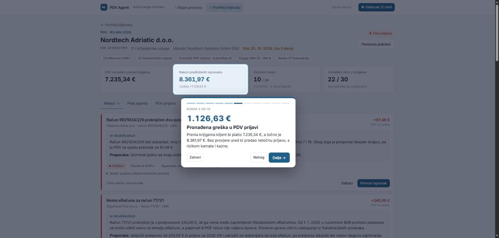
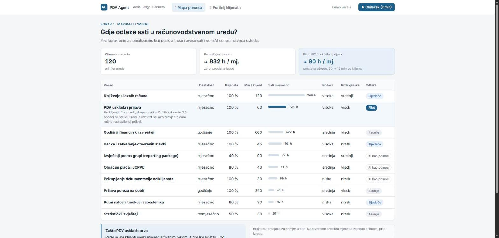
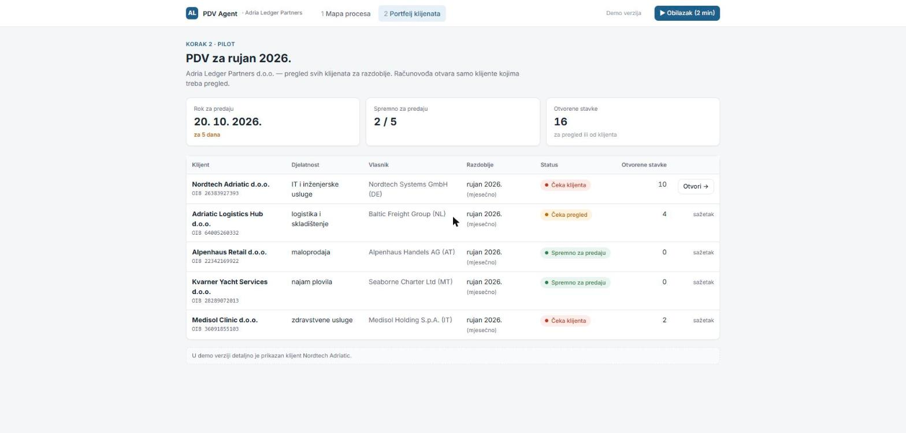
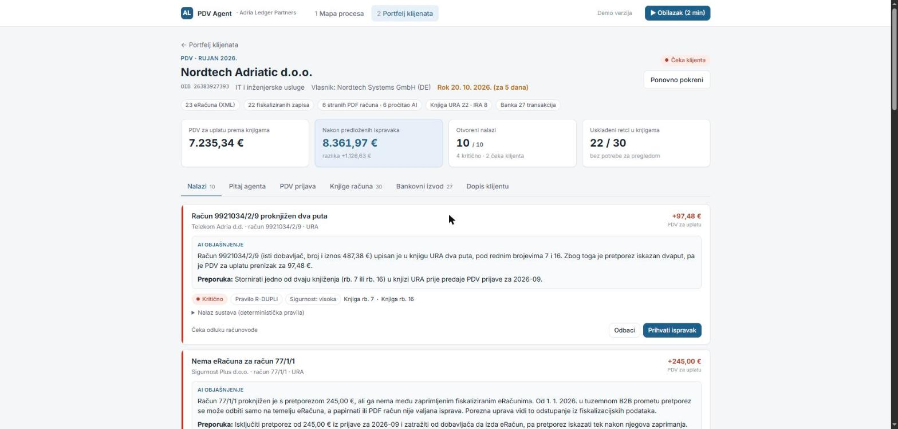
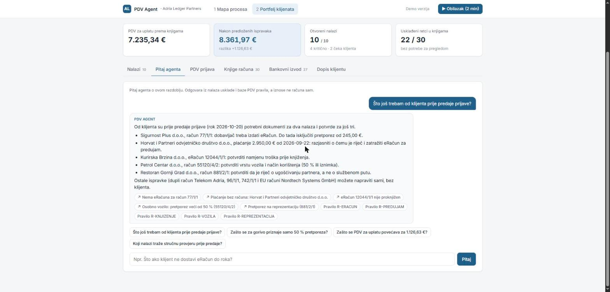
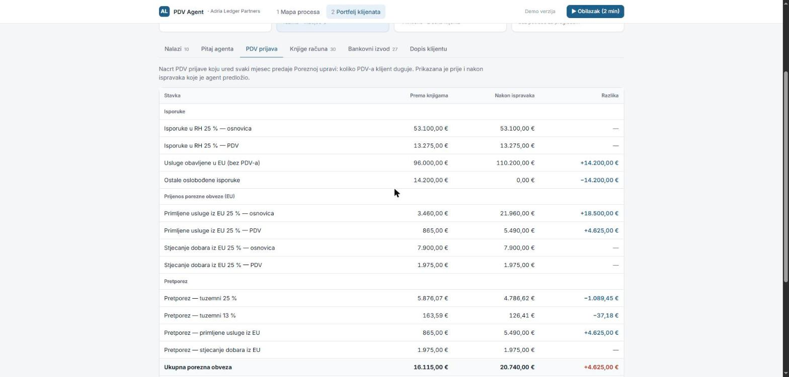
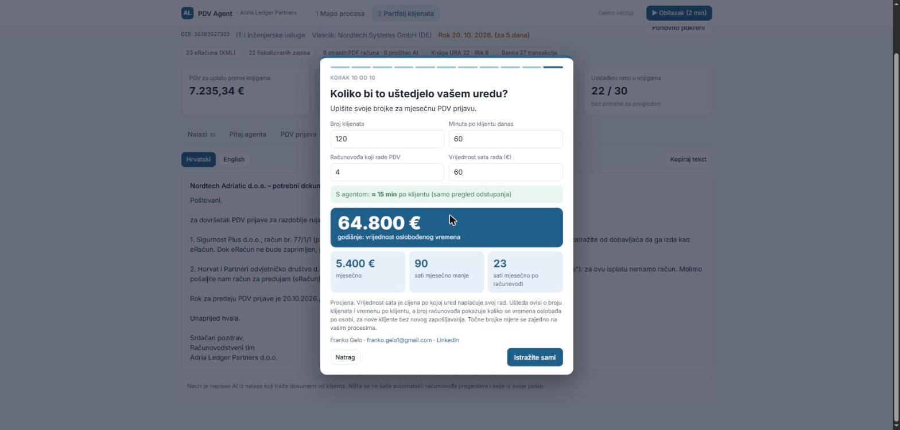

# PDV Agent: AI-assisted VAT reconciliation for accounting firms

An AI agent that prepares the monthly Croatian VAT return (PDV) for an accounting practice. It reconciles the client's books with fiscalized eRačuni (Fiskalizacija 2.0) and the bank statement, reads foreign PDF invoices, drafts the VAT return and EC Sales List (ZP), and flags every exception green / orange / red with a plain-language explanation. The accountant reviews only the exceptions and signs off. The interface is in Croatian, since it's built for Croatian accounting teams.

**▶ [Guided tour (2 min)](https://pdv-agent-wu6l.onrender.com/#/obilazak)**: walks through the real app step by step and ends with a calculator that estimates the time and money saved for your own firm. · **Live demo:** [pdv-agent-wu6l.onrender.com](https://pdv-agent-wu6l.onrender.com)

> All companies, people, tax numbers and amounts in this repository are **fictional**. The VAT rules are simplified and the law references must be verified by a tax professional before any real use.



## How I approached it

1. **Map & measure.** List the firm's recurring work, how often it happens, how long it takes, and how ready the data is for automation. The VAT reconciliation was picked as the pilot. Every client needs it every month, it has a hard deadline and costly errors, and since Fiskalizacija 2.0 (2026) the invoice data is structured. The numbers in the app are illustrative estimates; in a real engagement they are measured with the team first.
2. **Pilot one process.** AI does the groundwork; a human reviews the exceptions and signs off.
3. **Prove it.** The system is tested against a known correct answer, the same way you would test it against a return an accountant already prepared by hand.

| Process map | Client portfolio |
|---|---|
|  |  |

## What it does

For one client and one period (fictional **Nordtech Adriatic d.o.o.**, a Croatian subsidiary of a German group, September 2026), the agent:

1. **Reads the foreign PDF invoices with Claude**: number, date, VAT IDs, amounts, goods vs. services, reverse-charge note.
2. **Reconciles** the purchase/sales books (URA/IRA) against fiscalized eRačuni (UBL XML) and the bank statement, then applies VAT rules. It finds:
   - duplicate invoices,
   - invoices with no eRačun,
   - eRačuni that were never booked,
   - amounts that differ from the eRačun,
   - invoices outside the period,
   - EU services booked without reverse charge,
   - services to EU customers missing from the ZP form,
   - 50 % input VAT on passenger cars,
   - no input VAT on entertainment,
   - payments with no invoice.
3. **Explains each finding** in plain Croatian with a recommendation, the rule it relies on, a confidence level, and a flag when expert review is needed.
4. **Drafts the email to the client** (HR + EN) for the documents that are missing.
5. **Answers the accountant's questions** about the period ("What do I still need from the client?"), grounded in the findings and the VAT rules, with links back to the findings it relies on.
6. **Shows the VAT return before and after the proposed corrections.** Accepting or dismissing a finding updates the draft return and the client's status in the portfolio.
7. **Guided tour with a savings calculator.** A 10-step walkthrough of the real app focused on time and money saved; the last step lets a firm enter its own client count, minutes per client, team size and hourly value.

| Findings with AI explanations | Ask the agent |
|---|---|
|  |  |

| Draft VAT return | Savings calculator |
|---|---|
|  |  |

## Design: AI where judgment is needed, plain code where numbers are

An audit firm will not trust an LLM to calculate a tax return, so the system is split:

- **Deterministic code** does all matching and arithmetic. Amounts are integer cents. Every finding carries a proposed correction, so the effect of each finding on the VAT payable is computed exactly.
- **Claude** does only what needs reading or judgment:
  - extracts data from PDFs,
  - explains findings,
  - writes the client email.

  Every Claude answer is a JSON schema (structured outputs). Extracted PDF data is fed back into the rules as evidence and cross-checked against the books, never trusted blindly; a misread amount becomes a finding.
- **Prompt caching on disk:** responses are cached by request hash. The demo runs with no API key and at no cost, and a full live run costs about $0.20.

```
eRačuni (XML) ─┐                                    ┌─► findings 🟢🟠🔴 + AI explanation
foreign PDFs ──┼─► import ─► SQLite ─► rules engine ┼─► VAT return & ZP (before / after)
URA / IRA ─────┤        ▲                           └─► client email (HR / EN)
bank CSV ──────┘        └── Claude reads PDFs
```

## Results on the synthetic dataset

The generator injects 10 realistic errors and writes an answer key with the correct VAT return.

| Check | Result |
|---|---|
| Injected errors found | **10 / 10**, no false positives |
| Effect of each finding on VAT payable | exact to the cent |
| Corrected VAT return and ZP | equal to the answer key |
| Foreign PDFs read correctly by Claude | **6 / 6** |
| VAT payable | 7,235.34 € as booked → **8,361.97 €** correct (Δ 1,126.63 €) |

Run `npm test` to verify (20 tests, offline).

## Run it locally

Requires Node.js 24.

```bash
npm install
npm run demo     # generate data, import, reconcile (terminal output)
npm start        # dashboard at http://localhost:3000
```

The dashboard works from the committed AI cache without an API key. To run Claude live, copy `.env.example` to `.env` and set `ANTHROPIC_API_KEY`, then:

```bash
npm run agent    # full AI run in the terminal
```

## Project structure

```
scripts/generate-data.js   synthetic firm, clients, eRačuni, PDFs, books, bank, answer key
src/import.js              loads a client period into SQLite (node:sqlite)
src/core/reconcile.js      rules engine: matching, VAT rules, corrections, effects
src/core/vat.js            VAT return and ZP totals
src/ai/                    Claude client (structured outputs, cache), tasks, VAT rules file
src/server.js              Express API
src/web/public/            dashboard (vanilla JS, no build step)
test/                      reconciliation and AI-layer tests
```

## Limitations

- VAT rules are simplified. The return is grouped by meaning, not mapped to the official PDV / PDV-S form lines.
- Keyword-based rules (cars, entertainment) are marked lower-confidence and routed to human review.
- Built on synthetic data; a real deployment needs the firm's ERP export formats and a tax expert to own the rules.

Built with Node.js, SQLite and the Anthropic Claude API.
